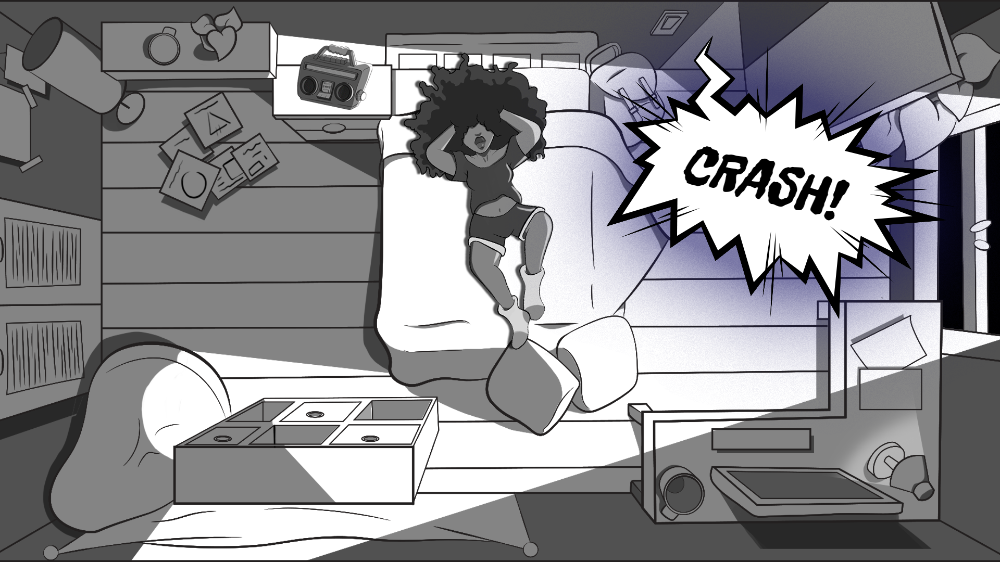

# Zenning

 

<!--- MARKUP NOTES 

TO HYPER LINK USE THIS FORMAT: [TEXT](HYPERLINK URL) 

# OR ## DICTATTES THE SIZE OF THE HEADING FONT  
 

EXAMPLE TABLE BELOW:

| TABLE TITLE 1 | Description| 

|-----|-----| 

| row1 | text needed | 

| row2 | text needed | 

|row3 | text needed | 

|row4 | text needed | 

 

EXAMPLE link image below:

 

--> 

# List of Contents 

 

1. [Overview](#1-Overview) 

2. [Features](#2-Features)

3. [Content](#3-Content) 

4. [Technologies Used](#4-Technologies-Used)  

5. [Deployment, Access & Extensions](#5-Deployment-Access-and-Extensions) 

6. [Credits](#6-Credits) 

7. [Copyright Notice](#7-Copyright-Notice) 
 

 

## 1. Overview

*Zenning* is a short Visual Novel game where the player plays as the protagonist, Anu - a young mum who's returned from work and is more stressed than ever! To calm down she must listen to the guided meditation leading her on a path to get into a 'Zen' state. Can you as the player get Anu to reach a 'Zen' state? Why not play and find out!?

This current version of *Zenning* is in the protyping phase with hopes to be developed further in 2027.  *Zenning* operates in the similar way as traditional Visual Novels.

## 2. Features

This section provides an overview of the features on the game, and the way in which theses feature(s) impact level progression.

-	**2.1 Game Controls** 

**Mouse: Left click**
    The game operates in the same way as traditional Visual Novel games, where left clicking progresses you through the game.

**Back button**
    As *Zenning* is a short game, it is unlikely players will need to use the 'back biutton' at the bottom of the game screen. However, clicking this button allows you to go back a precvious step in the game if needed.

-	**2.2 Level Progression** 
In this stage of development - players wil play through three short levels. In each level players are prompted to choose one out of three options in hope to promote a 'Zen state'. Each option will have the following consequences: 

| TABLE TITLE 1 | Description| 
|-----|-----| 
| Good choice | Progress to the next level, eventually attain the 'Good Ending'. | 
| Neutral choice | Repeat the same level. | 
| Bad choice | Sends player to the start of the game regardless of level. | 

Needless to say, the goal of the game is to achieve the 'Good Ending'.

## 3. Content

### **3.1 Assests: Artwork**

*Zenning*, including it's characters, artwork, visual assets, design elements, and prototype materials, has been created by the developer (myself) as has been provided for playtesting purposes only.

Unless I have explicitly given written permission, please do not:

- Repost, publish, distribute, or share the prototype or copies of the game.
- Extract, reproduce, redistribute, or reuse the game's assets or other content outside the playtest.
- Share private playtest materials, unreleased story content, screenshots, recordings, or gameplay footage publicly.
- Upload the game's assets or materials to other platforms or services.
- Please respect the confidentiality of unreleased content and do not share spoilers or private development materials outside the playtest group without written permission.
- This notice does not claim ownership over any third-party material that I do not own, nor does it override any rights you may have under applicable law.

### **3.2 Assets: Audio**

- ['Up All Night' - By Purrple Cat](https://purrplecat.itch.io/up-all-night)
- ['Inhalar, exhalar, respira, breathe' - by VikukaChannel via Pixabay](https://pixabay.com/sound-effects/people-inhalar-exhalar-respira-breathe-171044/)
- ['rubble crash' - by FreeEverythingxx via Pixabay](https://pixabay.com/sound-effects/film-special-effects-rubble-crash-275691/)
- ['Jumping on a Bed' - by freesound_community via Pixabay](https://pixabay.com/users/freesound_community-46691455/)

### **3.3 Assets: Fonts** 

The following fonts were used for the programmes hosting page: 
- **Freckle Face** - by Google Fonts

Rationale: These engine's default font did not compliment the overall aesthetic design of *Zenning*. As such, the font above was used to compliment the aesthetic tone of the game, maintaining the intended 'vintage cartoon' tone of the game itself. 

### **3.4 Colour Theme**

Using greyscale monochrome as the pimary colour theme intended to provide a bit of drama and visually convey the idea of experinicing 'mundane' situations. Further, the theme was selected with intent to encourage the player to focus on the narrative. While a more dynamic colour palletet could be benifitial to retaining player's attention, doing so could also run the risk of distracting players. 

## 4. Technologies Used

### **4.1 Languages**

- **Ren'Py script**: This is the native language supported in Ren'Py engine.
- **Python**: Some of the functions implemented in *Zenning's* script includes Python code. 

### **4.2 Applications, Libraries and Resources**

-   [GitHub](https://github.com/)
-   [Google Fonts](https://fonts.google.com/)
-   [Itch.io](https://itch.io/)
-   [Pixabay](https://pixabay.com/)
-   [Purple Cat - 'Up All Night' Album](https://purrplecat.itch.io/up-all-night)
-   [Ren'Py Documentation](https://www.renpy.org/doc/html/index.html)
-   [Ren'Py Engine](https://www.renpy.org/)
-   [Udemy](https://www.udemy.com/)
-   [Visual Studio Code](https://code.visualstudio.com/)
-   [Youtube](https://www.youtube.com/)

## 5. Deployment, Access, and Extensions

### **5.1 Deployment** 

*Zenning* has been deployed locally and online via the use of Ren'Py, GitHub (web application), Git Bash, Itch.io and an IDE such as VS Code. 

An overview of how the programme was accessed and deployed are outlined in the sections below.

### **:unlock: 5.2 Access: Local Clone via SSH Key**

|The Process – :key: SSH Key| 
|-------------|
|Note: You can use this key to clone the repo to the local space (e.g. on the desktop).|
|1.	Download the GitBash application and create a SSH key. How to create a SSH key can be found [here](https://inchoo.net/dev-talk/how-to-generate-ssh-keys-for-git-authorization/).|
|2.	Sign into [GitHub](https://github.com/).|
|3.	Click the profile icon in the top-right corner of the GitHub webpage, click **Settings**.|
|4.	Click SSH and GPG Keys tab on the left-hand menu.|
|5.	Click **‘New SSH Key’**, then copy and paste the key code (created via GitBash) into the box under the **’Key’** title.|
|6.	Click **’Add SSH Key’**, and then the key will then be ready to use!|

|The Process – Local Clone to an IDE of choice| 
|-------------|
|1.	Click the **’+’** icon in the top-right icon on the web browser and select **‘New Repository’**. You will then be directed to a webpage titled ‘Create a new repository’.| 
|2. Fill out the required areas. Ensure the repository has been assigned a name and has a README.md created. The README file can be added by selecting the **'Add a README file'** option at the bottom of the ‘Create a new repository’ form.|
|3. Copy the SSH key from the repo. See blow on how to do this: |

| :key: Implementing SSH Key |
|-------------|
|3.1 Open GitHub and navigate to the repo you want to clone.|
|3.2 Click the **’Code’** button in the top-right corner of the repo window.|
|3.3 Click the SSH Key tab.|
|3.4 Copy the SSH key via right click and copy or clicking the clipboard icon.|
|3.5 On the desktop, open VSCode.|
|3.6 On the taskbar at the top of tab, click the **File** tab.|
|3.7 Select the folder you want to clone the repo to.|
|3.8 In the terminal box, type **‘git clone’**.|
|3.9 Then copy the SSH key after the git clone command. Then press enter.|
|3.10 The terminal should present the pathway to the cloned repository. For instance, the programme will display the following in the VSCode’s terminal:| 
|- **…C:\Users\missm\Documents\GIT\game>**|
|3.11 Once cloned, you will be able to edit the repo locally and commit, pull and push changes to the online GitHub repo (remote repository) using terminal commands (e.g. 'git push', 'git add .' and 'git pull').| 

## 6. Credits

Thanks for all the contributors who's assets have been incorporated into this project:

- ['Up All Night' - By Purrple Cat](https://purrplecat.itch.io/up-all-night)
- ['Inhalar, exhalar, respira, breathe' - by VikukaChannel via Pixabay](https://pixabay.com/sound-effects/people-inhalar-exhalar-respira-breathe-171044/)
- ['rubble crash' - by FreeEverythingxx via Pixabay](https://pixabay.com/sound-effects/film-special-effects-rubble-crash-275691/)
- ['Jumping on a Bed' - by freesound_community via Pixabay](https://pixabay.com/users/freesound_community-46691455/)

## :warning: 7. Copyright Notice

© 2026. Sam Oladiran. Zenning and its original game materials are protected by applicable copyright and intellectual property laws, where applicable. All rights reserved in the original materials owned by the developer. No permission to reproduce, distribute, or commercially use these materials is granted by participation in this playtest.  

 

 

 

 